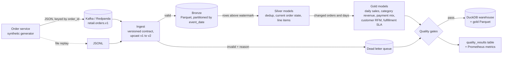

# retail-data-pipeline

[](https://github.com/pragathigopal7/retail-data-pipeline/actions/workflows/ci.yml)

A streaming retail orders pipeline that takes raw order events from Kafka, enforces a versioned schema contract at the edge, and builds a medallion lakehouse (bronze, silver, gold) on Parquet and DuckDB. Transforms run incrementally off a watermark, and data quality gates block bad data from reaching analytics and publish their results as metrics.

The event generator deliberately injects the problems real streams have, so the pipeline has something to prove:

| Problem in the stream | How the pipeline handles it |
|---|---|
| Duplicate deliveries (at least once Kafka semantics) | Deduplicated by `event_id` in silver |
| Late and out of order events | Order state is resolved by **event time**, never arrival time, so a late `PAID` cannot overwrite `DELIVERED` |
| Malformed payloads (missing fields, bad enums, naive timestamps, negative quantities) | Rejected by a Pydantic contract and routed to a dead letter queue with the reason |
| A producer that suddenly sends garbage | DLQ ratio budget fails the run before gold tables are trusted |
| Crash mid run | Offsets are committed only after a batch is durably written; re-runs resume from the checkpoint |
| Producer upgraded mid stream (schema v1 and v2 interleaved, even within one order) | Each event is validated against the version it declares and upcast to the latest, so downstream sees one shape |
| A producer that ships a schema version the registry doesn't know | Rejected to the DLQ with `schema_version` as the reason, never guessed at |
| Reprocessing everything on every run | Silver and gold rebuild only the orders and days touched by new events, in one transaction with the watermark |

## Architecture



| Layer | Tables | What happens |
|---|---|---|
| Layer | Tables | Materialized | What happens |
|---|---|---|---|
| Bronze | `order_events` | append | Validated, upcast events with source offset, ingest time and declared schema version, Hive partitioned by `event_date` |
| Silver | `silver_order_events` | append on `event_id` | Dedup within and across runs, keeping the first copy |
| Silver | `silver_orders`, `silver_order_items` | incremental on `order_id` | One row per order with lifecycle timestamps, current status, discounts and payment method; exploded line items |
| Gold | `gold_daily_store_sales`, `gold_category_revenue`, `gold_payment_mix` | incremental on `order_date` | Business facing daily aggregates, gross and net of discounts |
| Gold | `gold_customer_rfm`, `gold_fulfillment_sla` | table | Small global aggregates, rebuilt each run |

Transforms are plain SQL files in [`src/retail_pipeline/sql/`](src/retail_pipeline/sql), run in order. Each is a `SELECT` with a two line header saying how to materialize it, so they read like dbt models without the extra tooling.

## Quickstart

No infrastructure needed for file mode:

```bash
pip install -e ".[dev]"
retail-pipeline run --orders 5000
```

```
wrote 19365 events to lake/landing/events.jsonl
ingest: read=19365 valid=18910 dlq=455 batches=39
  dlq reason customer_id: 88
  dlq reason event_ts: 86
  ...
  dlq reason schema_version: 50
transform: mode=full_refresh new_events=18910 changed_orders=5000 changed_days=6
  silver_order_events             18387 rows
  ...
[PASS] line items reconcile to order total: 0 rows
[WARN] delivered orders were shipped first: 102 rows
[PASS] payment mix reconciles with daily sales: 0 rows
[PASS] dead letter ratio within budget: 0.0235 ratio
```

The `WARN` is expected: it flags orders whose `SHIPPED` event was malformed and sent to the DLQ, which is exactly the kind of gap an on call engineer would want surfaced. The `schema_version` DLQ rows are events from a producer that declared a version the registry does not know yet.

### With Kafka (Redpanda)

```bash
pip install -e ".[dev,kafka]"
make kafka-demo        # starts Redpanda + console, produces, ingests, transforms, checks
open http://localhost:8080   # Redpanda console to browse the topic
make kafka-down
```

The producer keys messages by `order_id` so all events for one order land in the same partition, and enables idempotent produce. The consumer disables auto commit and commits only after bronze and DLQ writes succeed.

## Querying the results

```python
import duckdb
con = duckdb.connect("lake/warehouse.duckdb")
con.sql("SELECT * FROM gold_fulfillment_sla").show()
con.sql("SELECT segment, COUNT(*), AVG(monetary) FROM gold_customer_rfm GROUP BY 1").show()
```

Sample fulfillment output (5,000 orders):

| store_id | delivered_orders | p50_hours | p90_hours |
|---|---|---|---|
| ST-0101 | 746 | 35.5 | 53.3 |
| ST-0207 | 821 | 36.1 | 52.1 |
| ST-0315 | 727 | 35.7 | 51.9 |

Payment mix after the v2 rollout (orders that only ever arrived as v1 report `unknown`, so totals still reconcile with daily sales, which a quality gate enforces):

| payment_method | orders | net revenue |
|---|---|---|
| unknown | 2500 | 638,198.68 |
| card | 1196 | 313,806.99 |
| wallet | 777 | 216,511.29 |
| gift_card | 394 | 97,985.94 |
| cash | 133 | 30,556.35 |

## Schema evolution

The contract lives in [`schemas.py`](src/retail_pipeline/schemas.py) as a small registry keyed by `schema_version`:

| Version | Adds | Notes |
|---|---|---|
| v1 | the original order event | events with no `schema_version` are treated as v1 |
| v2 | `payment_method` per order, `discount` per line item | additive, so v1 upcasts losslessly (no payment method, zero discount) |

Ingest uses a Pydantic discriminated union on `schema_version`: each event is validated against exactly the version it claims, then upcast to the latest. Bronze stores one shape plus `source_schema_version`, so you can watch a producer rollout (`SELECT source_schema_version, COUNT(*) FROM bronze_order_events GROUP BY 1`). Bronze is read with `union_by_name`, so Parquet files written before a column existed still load, with the new columns as NULL.

The generator simulates the rollout: orders in the first half of a run are v1, the rest v2, and a small share of events declare v3 to exercise the unknown version path.

## Incremental models

`retail-pipeline transform` is incremental by default:

1. The bronze high water mark on `ingested_at` is pinned, and only rows between the stored watermark and it are read (`new_bronze`).
2. `append` models insert rows whose key is not present yet, so a duplicate that arrives a day later is still dropped.
3. The orders touched by new events, and both the day they used to map to and the day they map to now, become `changed_order_id` and `changed_order_date`. A late `PLACED` event can move an order to an earlier day, and the old day must not keep a stale row.
4. `incremental` models delete and rebuild only those keys. `table` models rebuild in full.
5. The watermark advances in the same transaction as the model writes, so a failure leaves the warehouse and watermark exactly as they were and the next run retries the same rows.

```
transform: mode=full_refresh new_events=9457 changed_orders=3539 changed_days=3
transform: mode=incremental new_events=9453 changed_orders=3542 changed_days=6
transform: mode=noop new_events=0 changed_orders=0 changed_days=0
```

`retail-pipeline transform --full-refresh` ignores the watermark and rebuilds everything. The test suite checks that several incremental runs produce exactly the same tables as one full refresh.

## Quality history and metrics

Every `check` run is appended to a `quality_results` table in the warehouse and written to `lake/metrics/quality.prom` in the Prometheus text format, ready for a node_exporter textfile collector:

```
retail_quality_check_observed{check="delivered_orders_were_shipped_first",severity="warn"} 102
retail_quality_check_passed{check="dead_letter_ratio_within_budget",severity="error"} 1
retail_quality_blocking_failures 0
retail_quality_last_run_timestamp_seconds 1793057518
```

Alert on `retail_quality_blocking_failures > 0`, or on `time() - retail_quality_last_run_timestamp_seconds` to catch a pipeline that stopped running. Recent runs from the CLI:

```bash
retail-pipeline quality-history
```

## Project layout

```
src/retail_pipeline/
  schemas.py      versioned event contracts (v1, v2), registry and upcasting
  generator.py    synthetic order lifecycles with injected faults and a v2 rollout
  sources.py      FileSource / KafkaSource with checkpointed offsets, Kafka producer
  ingest.py       validation, bronze Parquet writes, dead letter queue
  transform.py    incremental model runner (watermark, append/incremental/table), gold Parquet export
  quality.py      blocking and warning checks, quality_results history, Prometheus metrics
  sql/            silver and gold models with materialization headers
tests/            contracts and evolution, dedup, late events, checkpointing, incremental
                  equivalence, rollback, quality history, end to end gates
```

## Tests

```bash
make test lint
```

The suite covers the schema contract and its evolution (upcasting, unknown versions, mixed versions in one order, bronze files written before v2), generator determinism, DLQ routing, checkpoint resume, deduplication, late event handling, revenue exclusion for cancelled orders, incremental runs matching a full refresh, a late event moving an order between days, rollback of a failed transform, quality history, and an end to end run where every blocking gate must pass. CI runs it on Python 3.10 and 3.12 plus a full 5,000 order pipeline run.

## Design notes

* **Why validate at ingest instead of in silver?** A contract at the edge means bronze is always queryable with a known schema, and bad producers show up immediately as DLQ volume rather than as subtle nulls three tables later.
* **Why event time for state?** Mobile clients and retries make arrival order unreliable. Resolving status with `ARG_MAX(status, (event_ts, lifecycle_rank))` makes the result independent of delivery order.
* **Why upcast at ingest instead of handling versions in SQL?** Version logic lives in one place, next to the contract. Silver and gold never branch on `schema_version`, and adding v3 means one model plus one `upcast`.
* **Why delete and insert by key instead of MERGE?** Every incremental model is a pure function of its inputs for a set of keys, so rebuilding a slice is simple to reason about and trivially idempotent. It is also how dbt's `delete+insert` strategy works, so the models port directly.
* **Why DuckDB?** It gives warehouse style SQL over Parquet with zero infrastructure. The bronze and gold layers are plain Parquet, so the same models port directly to Spark, Trino, or Snowflake external tables.

## Possible extensions

* Move the contract registry to a Confluent or Redpanda schema registry with compatibility checks in CI
* Orchestrate with Airflow or Dagster, using `changed_order_date` to trigger downstream partitions
* Late data budget: alert when events arrive more than N hours behind the watermark

## License

MIT
