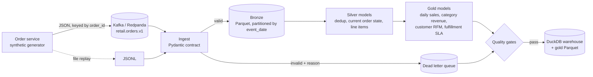

# retail-data-pipeline

[](https://github.com/pragathigopal7/retail-data-pipeline/actions/workflows/ci.yml)

A streaming retail orders pipeline that takes raw order events from Kafka, enforces a schema contract at the edge, and builds a medallion lakehouse (bronze, silver, gold) on Parquet and DuckDB, with data quality gates that block bad data from reaching analytics.

The event generator deliberately injects the problems real streams have, so the pipeline has something to prove:

| Problem in the stream | How the pipeline handles it |
|---|---|
| Duplicate deliveries (at least once Kafka semantics) | Deduplicated by `event_id` in silver |
| Late and out of order events | Order state is resolved by **event time**, never arrival time, so a late `PAID` cannot overwrite `DELIVERED` |
| Malformed payloads (missing fields, bad enums, naive timestamps, negative quantities) | Rejected by a Pydantic contract and routed to a dead letter queue with the reason |
| A producer that suddenly sends garbage | DLQ ratio budget fails the run before gold tables are trusted |
| Crash mid run | Offsets are committed only after a batch is durably written; re-runs resume from the checkpoint |

## Architecture



| Layer | Tables | What happens |
|---|---|---|
| Bronze | `order_events` | Validated events with source offset and ingest time, Hive partitioned by `event_date` |
| Silver | `silver_order_events`, `silver_orders`, `silver_order_items` | Dedup, one row per order with lifecycle timestamps and current status, exploded line items |
| Gold | `gold_daily_store_sales`, `gold_category_revenue`, `gold_customer_rfm`, `gold_fulfillment_sla` | Business facing aggregates, also exported as Parquet for any engine |

Transforms are plain SQL files in [`src/retail_pipeline/sql/`](src/retail_pipeline/sql), run in order, so they read like dbt models without the extra tooling.

## Quickstart

No infrastructure needed for file mode:

```bash
pip install -e ".[dev]"
retail-pipeline run --orders 5000
```

```
wrote 19365 events to lake/landing/events.jsonl
ingest: read=19365 valid=18959 dlq=406 batches=39
  dlq reason customer_id: 88
  dlq reason event_ts: 86
  ...
  silver_order_events             18435 rows
  silver_orders                    5000 rows
  ...
[PASS] silver_order_events.event_id is unique: 0 rows
[PASS] line items reconcile to order total: 0 rows
[WARN] delivered orders were shipped first: 93 rows
[PASS] dead letter ratio within budget: 0.021 ratio
```

The `WARN` is expected: it flags orders whose `SHIPPED` event was malformed and sent to the DLQ, which is exactly the kind of gap an on call engineer would want surfaced.

### With Kafka (Redpanda)

```bash
pip install -e ".[dev,kafka]"
make kafka-demo        # starts Redpanda + console, produces, ingests, transforms, checks
open http://localhost:8080   # Redpanda console to browse the topic
make kafka-down
```

The producer keys messages by `order_id` so all events for one order land in the same partition, and enables idempotent produce. The consumer disables auto commit and commits only after bronze and DLQ writes succeed.

## Querying the results

```python
import duckdb
con = duckdb.connect("lake/warehouse.duckdb")
con.sql("SELECT * FROM gold_fulfillment_sla").show()
con.sql("SELECT segment, COUNT(*), AVG(monetary) FROM gold_customer_rfm GROUP BY 1").show()
```

Sample fulfillment output (5,000 orders):

| store_id | delivered_orders | p50_hours | p90_hours |
|---|---|---|---|
| ST-0101 | 752 | 35.5 | 53.2 |
| ST-0207 | 822 | 36.1 | 52.1 |
| ST-0315 | 732 | 35.7 | 51.8 |

## Project layout

```
src/retail_pipeline/
  schemas.py      event contract (Pydantic)
  generator.py    synthetic order lifecycles with injected faults
  sources.py      FileSource / KafkaSource with checkpointed offsets, Kafka producer
  ingest.py       validation, bronze Parquet writes, dead letter queue
  transform.py    runs the SQL models in DuckDB, exports gold Parquet
  quality.py      blocking and warning data quality checks
  sql/            silver and gold models
tests/            contract, dedup, late events, checkpointing, end to end gates
```

## Tests

```bash
make test lint
```

The suite covers the schema contract, generator determinism, DLQ routing, checkpoint resume, deduplication, late event handling, revenue exclusion for cancelled orders, and an end to end run where every blocking gate must pass. CI runs it on Python 3.10 and 3.12 plus a full 5,000 order pipeline run.

## Design notes

* **Why validate at ingest instead of in silver?** A contract at the edge means bronze is always queryable with a known schema, and bad producers show up immediately as DLQ volume rather than as subtle nulls three tables later.
* **Why event time for state?** Mobile clients and retries make arrival order unreliable. Resolving status with `ARG_MAX(status, (event_ts, lifecycle_rank))` makes the result independent of delivery order.
* **Why DuckDB?** It gives warehouse style SQL over Parquet with zero infrastructure. The bronze and gold layers are plain Parquet, so the same models port directly to Spark, Trino, or Snowflake external tables.

## Possible extensions

* Swap the batch transform for incremental models keyed on `ingested_at`
* Register schemas in a schema registry and evolve to `schema_version` 2
* Orchestrate with Airflow or Dagster and publish quality results as metrics

## License

MIT
